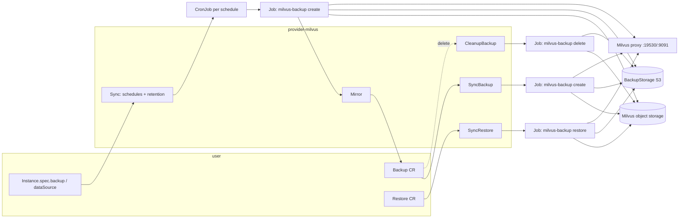

# Design: Backup and restore for Milvus

- Status: Draft
- Issues: #9 (backup integration), #10 (restore workflows)
- Roadmap: Phase 4
- Last updated: 2026-10-12

## 1. Summary

Milvus instances get on-demand backups, scheduled backups with retention,
in-place restores, and seeding of a new instance from a backup. The provider
ships a `ProviderManaged` BackupClass named `milvus-backup`. For every backup,
restore and delete it runs the upstream
[milvus-backup](https://github.com/zilliztech/milvus-backup) CLI as a
short-lived Kubernetes Job that it owns and watches. Point-in-time recovery is
out of scope. Milvus has no change stream that milvus-backup can replay.

## 2. Goals and non-goals

Goals:

- `Backup` CRs (on demand) produce a restorable copy of every collection, with
  RBAC metadata optional, in any S3-compatible `BackupStorage`.
- `spec.backup.storages[].schedules` on the Instance produce `Backup` CRs on a
  cron schedule and enforce count- or time-based retention.
- A `Restore` CR restores a backup into an existing Instance.
- `Instance.spec.dataSource` seeds a new Instance from a backup taken from
  another Instance, or from an imported (External) backup.
- Deleting a `Backup` with `deletionPolicy: Delete` removes its data from storage.
- Works with bundled MinIO and external object storage, in both topologies,
  with Woodpecker and Pulsar.

Non-goals (for now):

- PITR. The class advertises `supportsPITR: false`. A future path is Milvus CDC.
- Non-S3 `BackupStorage` types. Core only supports `s3` today. milvus-backup
  supports GCS and Azure, so the mapping layer is written to grow.
- Backing up index files. milvus-backup stores raw data plus index *metadata*
  and rebuilds indexes on restore (see section 4).
- Cross-version restore guarantees beyond milvus-backup's matrix: a backup
  restores only into the same or a newer Milvus version.

## 3. Constraints from the OpenEverest framework

These come from `openeverest/api` and `provider-runtime`:

| Constraint | Source | Consequence |
|---|---|---|
| `Instance.spec.backup.classRef` must be a `ProviderManaged` class | `InstanceBackupSpec` doc | A `Job`-mode class cannot be enabled on an Instance. |
| `spec.dataSource` only accepts `ProviderManaged` classes | `Context.ReconcileDataSource` | Seeding (#10) requires ProviderManaged. |
| Runtime never spawns CronJobs for ProviderManaged classes. Schedules use the engine's native scheduler, and results are mirrored into `Backup` CRs | `InstanceBackupStorage.Schedules` doc, `BackupMirror` | The provider owns scheduling. |
| `BackupProvider` = `SyncBackup` / `SyncRestore` / `CleanupBackup` / `CleanupRestore`; optional `BackupWatcher`, `RestoreWatcher`, `BackupMirror`, `BackupImporter` | `provider-runtime/controller/interface.go` | Interfaces we implement. |
| Instance deletion with `deletionPolicy: Cascade` deletes child Backups/Restores **before** `Cleanup` | `reconciler/provider.go` `handleDeletion` | `CleanupBackup` can still read the Instance and Milvus CR. |
| Seeding requires the target Instance to list the source Backup's storage in `spec.backup.storages` | `ReconcileDataSource` step 3 | Documented user requirement, same as PSMDB. |
| `BackupStorage` = S3 only: bucket, region, endpointURL, verifyTLS, forcePathStyle, Secret with `AWS_ACCESS_KEY_ID` / `AWS_SECRET_ACCESS_KEY` | `backupstorage_types.go` | Mapping in section 7.3. |

Job execution mode was rejected for three reasons. It is unusable for
`Instance.spec.backup` and `spec.dataSource`. Its payload (`jobspec.Spec`)
carries the instance's client endpoint but not Milvus's *own* object storage
(bucket, rootPath, credentials), and milvus-backup needs that storage. It also
cannot schedule.

## 4. milvus-backup: facts we rely on (v0.6.0, 2026-09-16)

Checked against the v0.6.0 source and docs:

- Image: `milvusdb/milvus-backup:v0.6.0` (amd64 and arm64, Alpine-based,
  `ENTRYPOINT ["/app/milvus-backup","server"]`, so we override the command).
- Version matrix: it backs up Milvus 2.2 and later and restores into 2.5 and
  later. A backup restores only into the same or a newer version.
- Backup reads Milvus metadata over gRPC (`19530`). It flushes and copies
  sealed-segment binlogs from **Milvus's object storage** into the **backup
  storage**. It optionally pauses GC through the management endpoint (`9091`,
  `backup.pauseGC: true` by default). Since 0.5.4 it reads exact binlog lists
  through the REST API (`GetSegmentInfo`, Milvus ≥ 2.5.8). Milvus 2.6 serves
  REST on the proxy port.
- Restore copies binlogs from backup storage into Milvus's bucket and
  BulkInserts them. Milvus can only import from its own bucket, so
  `milvus.storage` must describe the *target* Milvus storage exactly
  (bucket, rootPath and endpoint). Wrong values give `no binlog to import` or
  `segment has no insert logs`.
- Index files are not backed up. Restore needs `--rebuild_index` for
  collections to be loadable.
- 2.6 targets must be **≥ 2.6.12** for restore. Older versions hit an L0
  compaction bug during BulkInsert (milvus-io/milvus#48114). Our catalog ships
  2.6.10 and 2.6.11 (default 2.6.11).
- On Milvus 2.6 the backup format is `binlog`, streamed through the
  milvus-backup pod (`transfer.mode: auto`). The `snapshot` format needs
  Milvus ≥ 3.0.1.
- Config file `configVersion: v2`. Credentials come **only** from env vars:
  `MILVUS_USER`, `MILVUS_PASSWORD`,
  `MILVUS_STORAGE_AUTH_ACCESS_KEY_ID` / `..._SECRET_ACCESS_KEY`,
  `BACKUP_STORAGE_AUTH_ACCESS_KEY_ID` / `..._SECRET_ACCESS_KEY`. Everything
  else lives in the file. Service-injected `*_PORT` / `*_HOST` env vars are
  deliberately ignored.
- `backup.storage` inherits unset fields from `milvus.storage`, except
  `rootPath`, which defaults to `backup`.
- Backup names allow only `[A-Za-z0-9_]`.
- Layout: `<backup bucket>/<backup rootPath>/<backup name>/…` (meta plus
  binlogs).
- `delete` needs only the backup storage. It refuses to delete when it cannot
  read the backup's meta and errors on unknown names.
- The S3 client is minio-go. There is no option to skip TLS verification, and
  bucket lookup is automatic (path-style for non-AWS endpoints).
- Relevant flags:
  - `create`: `-n`, `--filter db.coll,db.*`, `--rbac`, `--strategy`.
  - `restore`: `-n`, `--filter`, `--suffix`, `--rename`, `--rebuild_index`,
    `--drop_exist_collection`, `--drop_exist_index`, `--rbac`,
    `--use_v2_restore`.

## 5. Design overview



Every operation is a Job running one milvus-backup command. The Job takes its
config from a ConfigMap and its credentials from Secrets referenced as env
vars. The provider renders both from:

1. the **live Milvus CR**, which describes the instance's object storage after
   operator defaulting, and
2. the **BackupStorage** that the Backup references.

## 6. BackupClass definition

`definition/backupclasses/milvus-backup/class.yaml` (scaffold with
`provider-sdk add backupclass --name milvus-backup`):

```yaml
displayName: "Milvus Backup"
description: |
  Logical backups of Milvus collections with milvus-backup. Raw data and index
  metadata are copied to an S3-compatible BackupStorage; indexes are rebuilt
  on restore. Point-in-time recovery is not supported.
supportedProviders:
  - milvus
executionMode: ProviderManaged
parametersSchema:
  openAPIV3Schema: MilvusBackupParameters
restoreParametersSchema:
  openAPIV3Schema: MilvusRestoreParameters
providerManaged:
  supportsPITR: false
```

`types.go`. Every field is optional and the defaults are listed:

```go
type MilvusBackupParameters struct {
    // Collections limits the backup, in milvus-backup --filter syntax
    // ("coll", "db.coll", "db.*"). Empty backs up every collection.
    Collections []string `json:"collections,omitempty"`
    // IncludeRBAC also backs up users, roles and grants. Default false.
    IncludeRBAC bool `json:"includeRBAC,omitempty"`
}

type MilvusRestoreParameters struct {
    // Collections limits the restore (names after renaming). Empty = all.
    Collections []string `json:"collections,omitempty"`
    // CollectionSuffix restores next to existing collections instead of over
    // them (e.g. "_restored").
    CollectionSuffix string `json:"collectionSuffix,omitempty"`
    // DropExistingCollections drops a same-named target collection first.
    // Default true for Restore into an existing Instance (section 8.4).
    DropExistingCollections *bool `json:"dropExistingCollections,omitempty"`
    // RebuildIndexes recreates indexes from backed-up metadata so restored
    // collections are loadable. Default true.
    RebuildIndexes *bool `json:"rebuildIndexes,omitempty"`
    // IncludeRBAC restores users, roles and grants if the backup has them.
    IncludeRBAC bool `json:"includeRBAC,omitempty"`
}
```

Excluded on purpose: `--strategy`, `--format`, concurrency knobs, and
`--use_v2_restore`. They are tuning, not user intent. If needed they become
provider Helm values.

`ui.yaml`: collections as a tag list, plus RBAC and drop/rebuild toggles. The
restore drawer shows the "existing collections are dropped" warning.

## 7. Job anatomy

### 7.1 Objects per operation

| Operation | Job / ConfigMap name | Owner (controller ref) | Command |
|---|---|---|---|
| On-demand backup | `<backup>-mb` (hashed when > 63) | Backup | `create -n <mbName> [--filter] [--rbac]` |
| Scheduled backup | created by the CronJob `<instance>-<schedule>-mb` | CronJob (Backup mirrored, section 8.2) | same |
| Restore | `<restore>-mr` | Restore | `restore -n <mbName> --rebuild_index [--drop_exist_collection] [--filter] [--suffix] [--rbac]` |
| Delete | `<backup>-md` | Backup | `delete -n <mbName>` |

Common Job settings:

- `backoffLimit: 0`. A retried `create` would collide with the half-written
  backup of the same name, so the user retries by creating a new Backup.
- `ttlSecondsAfterFinished` is unset. The owner reference handles garbage
  collection, and the Job holds the failure message until the Backup is gone.
- `terminationMessagePolicy: FallbackToLogsOnError`. The tail of the
  milvus-backup log becomes the container's termination message, which the
  provider copies into `Backup.status.message` on failure.
- `--config /etc/milvus-backup/backup.yaml` from the ConfigMap. Logs go to the
  console only. `/tmp` is an `emptyDir`.
- Pod security: `runAsNonRoot`, `readOnlyRootFilesystem`, all capabilities
  dropped, `seccompProfile: RuntimeDefault`. The image runs as root by
  default, so we set `runAsUser: 65532`. The spike (section 13) confirms this
  works with a read-only root and console-only logging.
- Image comes from provider Helm values (`backup.image`, default
  `milvusdb/milvus-backup:v0.6.0`) and reaches the provider as an env var.
  Air-gapped installs override it. Resources come from Helm values too
  (default requests `250m` / `512Mi`). Streaming binlog copies is network-
  and CPU-bound.
- `serviceAccountName`: the Milvus CR's `spec.components.serviceAccountName`
  when the instance uses IAM for its storage, otherwise `default` with
  `automountServiceAccountToken: false`. The Job never calls the Kubernetes API.

### 7.2 Milvus side (`milvus.*`), resolved from the live Milvus CR

| Key | Value |
|---|---|
| `milvus.grpc.address` / `port` | `<instance>-milvus.<ns>.svc` / `19530` (ClusterIP service, all exposure types) |
| `milvus.management.endpoint` | `http://<instance>-milvus.<ns>.svc:9091` |
| `milvus.user` / `MILVUS_PASSWORD` | `root` / env from Secret `<instance>-credentials` key `password` |
| `milvus.storage.provider` | bundled → `minio`; external: `spec.dep.storage.type` / `minio.cloudProvider` → `minio`, `aws`, `gcp`, `azure` |
| `address` / `port` | `spec.dep.storage.endpoint` (webhook-defaulted to `<instance>-minio.<ns>:9000`) |
| `bucketName` | `spec.config.minio.bucketName`, default `milvus-bucket` (operator `defaultBucketName`) |
| `rootPath` | `spec.config.minio.rootPath`, default `files` (Milvus default) |
| `useSSL` / `region` | `spec.config.minio.useSSL` / `.region` |
| `auth` | `useIAM` → `type: iam`; else `static`, with env from Secret `spec.dep.storage.secretRef`, keys `accesskey`/`secretkey` or `rootUser`/`rootPassword` (the same fallback as the operator's `storageSecretKeys`; we pick whichever pair exists) |

Reading the Milvus CR, not the Instance params, keeps backups correct for
instances whose storage settings came from operator defaulting or from before
the provider pinned them.

### 7.3 Backup side (`backup.*`), from the BackupStorage

| BackupStorage | milvus-backup |
|---|---|
| `s3.endpointURL` | `address`, `port`, `useSSL` (parsed. Default port 443/80. No endpoint → `s3.<region>.amazonaws.com:443`) |
| `s3.bucket` / `region` | `bucketName` / `region` |
| `s3.forcePathStyle` | no knob. minio-go picks path-style for non-AWS hosts. Reject `forcePathStyle: true` with an AWS endpoint at validation |
| `s3.verifyTLS: false` | **unsupported**. Fail validation with a clear message. Custom CA via the provider chart is a follow-up |
| credentials Secret | env `BACKUP_STORAGE_AUTH_ACCESS_KEY_ID` / `..._SECRET_ACCESS_KEY` ← keys `AWS_ACCESS_KEY_ID` / `AWS_SECRET_ACCESS_KEY` |
| provider | `aws` for `*.amazonaws.com`, else `s3` |
| `rootPath` | `everest/milvus/<namespace>/<instance>`; see section 7.4 |

`BackupStorage` and its Secret are in the Backup's namespace, which is also the
Job's namespace, so `secretKeyRef` works without copying the Secret.

### 7.4 Naming and layout

- **milvus-backup name** = Backup name with `-` and `.` mapped to `_`
  (`daily-2026-10-12` → `daily_2026_10_12`). Kubernetes names are unique per
  namespace, so `a-b` vs `a.b` is the only possible collision. `SyncBackup`
  fails the second one with a clear message.
- **rootPath** = `everest/milvus/<namespace>/<instance>`. It is stable and
  derivable from the Backup alone (`origin.instanceRef` plus namespace), so a
  restore into *another* Instance finds the data without extra state. It is
  namespaced so that same-named instances sharing a bucket don't collide.
- **External / imported backups** use `spec.origin.external.path` =
  `<rootPath>/<mbName>`. The last segment is the name and the rest is the
  rootPath. This matches the PSMDB convention.

## 8. Flows

### 8.1 On-demand backup (`SyncBackup`)

1. Resolve the Instance, the Milvus CR and the BackupStorage. If the Milvus CR
   is missing or not `Healthy` → `Pending` ("waiting for Milvus to be
   healthy").
2. Serialize per instance. If another backup, restore or delete Job for this
   instance is active → `Pending` ("waiting for <other>"). Concurrent
   pause/resume of GC and concurrent flushes are not worth the risk.
3. Ensure the ConfigMap and Job (controller ref = Backup). Return
   `OperatorBackupRef{Group: batch, Kind: Job, Name}`.
4. Map the Job status: active → `Running` (`startedAt` = Job `startTime`).
   `Complete` → `Succeeded` (`completedAt`). `Failed` → `Failed` with the
   termination message.
5. `BackupWatcher` watches owned Jobs, so state changes enqueue the Backup
   directly.

Size: v1 leaves `status.size` empty. Phase 3 reads `backup_meta` from storage
(shared with the importer) and fills it in.

### 8.2 Scheduled backups

`Sync` reconciles one CronJob per enabled `schedules[]` entry:

- `<instance>-<schedule>-mb`, `concurrencyPolicy: Forbid`,
  `startingDeadlineSeconds: 300`, history limits 3/3. The Job template is the
  same as in section 8.1, except a small `sh` wrapper reads the Job's name from
  `JOB_NAME` (downward API on the pod label `batch.kubernetes.io/job-name`).
  It maps the name per section 7.4 and passes it as `-n`.
- Labels: `app.kubernetes.io/instance`,
  `backup.milvus.openeverest.io/{schedule,storage,class}`.
- Disabled or removed schedules → the CronJob is deleted (selected by label).
- `BackupMirror`: `OperatorBackupType()` = `batchv1.Job`. `Mirror` returns a
  `Backup{name: job.Name, origin: instance, storageRef, classRef,
  scheduleName}` for Jobs carrying the schedule label, and nil otherwise.
  `SyncBackup` sees `spec.scheduleName`, finds the Job by name and maps status
  without creating anything. A missing Job → `Failed` ("scheduled job was
  removed before completion").

Retention is enforced in `Sync`. For each schedule, list Backups with
`spec.scheduleName == name` in state `Succeeded` and delete the ones outside
`retention` (count: keep the newest N; time: `completedAt` older than the
window). Deletion goes through `CleanupBackup`, so storage is purged unless
the Backup says `Retain`. Failed scheduled Backups beyond 3 per schedule are
deleted too, to bound clutter.

Wiring errors (unparsable cron, missing storage) return
`controller.BackupConfigError`. The runtime surfaces that on the
`BackupConfigured` condition without failing the Instance.

#### Alternative considered: CronJob creates Backup CRs

A CronJob running the provider image with a `create-backup` subcommand would
create `Backup` CRs, and all execution would go through `SyncBackup`. That
removes the mirror and the Job-name gymnastics. The cost is a ServiceAccount,
Role and RoleBinding per namespace, all created by the provider, which grants
`create backups`. We prefer the mirror because it matches the framework's
documented pattern and the provider never mints RBAC. Revisit if the
cluster-wide `Job` informer (the mirror watches all Jobs) proves costly. That
informer is mitigated by a label-selected cache for `batchv1.Job` in the
provider manager options.

### 8.3 Delete (`CleanupBackup`)

- `deletionPolicy: Retain`, or the Backup never reached `Succeeded` →
  done immediately. A failed `create` may leave partial objects under
  `<rootPath>/<mbName>/`. Tracked as an open question.
- Otherwise ensure the Job `<backup>-md` (`delete -n`). This needs only the
  backup side of the config. `Complete` → done. `Failed` with "read backup
  info" (already gone) → done. Any other failure → retry with backoff and
  surface the message. A 3-attempt cap is followed by a done-with-warning
  Event, so a deleted bucket cannot block namespace deletion forever.

### 8.4 Restore into an existing Instance (`SyncRestore`)

1. Resolve the source: `dataSource.type: Backup` → Backup CR (must be
   `Succeeded`). Its rootPath is derived per section 7.4, or from
   `external.path`. `PointInTime` → `Failed` (unsupported).
2. Target Milvus must be `Healthy` and at a version ≥ 2.6.12. When the source
   Instance still exists, its version must be ≤ the target's. Otherwise →
   `Failed` with an explanation.
3. Serialize with other Jobs for the instance (section 8.1 step 2).
4. Job `restore -n <mbName> --rebuild_index --drop_exist_collection …`. The
   backup side comes from the **source Backup's** storage, and the Milvus side
   from the **target** Milvus CR.
5. While a Restore is `Running`, `Status()` reports `Restoring`. A
   `RestoreWatcher` on owned Jobs, plus watching Restores from the Instance
   (as PSMDB does), keeps the phase from lagging.

Semantics: a Restore makes every collection in the backup equal to its
backed-up contents. Collections created after the backup are **left alone**.
milvus-backup restores per collection and has no "replace the whole instance"
mode. The UI states this. A strict "reset instance" option (drop all
collections first) is an open question.

### 8.5 Seeding a new Instance (`spec.dataSource`)

`Sync` calls `c.ReconcileDataSource()` every pass. It creates the
`<instance>-datasource` Restore, which `SyncRestore` executes as in section 8.4
once the new Milvus is `Healthy`. Until then the Restore stays `Pending`. Unlike
PSMDB, the engine must be running to be seeded. `Status()` returns
`Restoring` while `!ds.Done`, so connection details are published only after
seeding. On a fresh instance `--drop_exist_collection` is a no-op.

Users must list the source backup's storage in the new Instance's
`spec.backup.storages`. The runtime enforces this and reports
`DataSourceStorageMismatch`.

### 8.6 Import existing backups (`BackupImporter`), phase 3

List `<prefix>/*/meta/` in the storage, parse the milvus-backup meta files
(name, timestamps, size), and return External Backups named deterministically
from the path. This needs an S3 client in the provider, which also enables
`status.size`.

## 9. Validation (`Validate`)

When `spec.backup.enabled`:

- `classRef` is `milvus-backup`, `ValidateInstanceBackupAgainstClass` passes,
  and every `storageRef` exists and is `s3`.
- `verifyTLS: false`, or `forcePathStyle: true` with an AWS endpoint, is
  rejected (section 7.3).
- Cron expressions parse (`robfig/cron/v3` standard parser).

Versions below 2.6.12 can still be backed up. Restores into them are refused
in `SyncRestore` (section 8.4).

Backup and Restore parameters are already schema-validated by core against
the class schemas.

## 10. RBAC additions (`internal/provider/rbac.go`)

```go
// +kubebuilder:rbac:groups=backup.openeverest.io,resources=backups;restores,verbs=get;list;watch;create;update;patch;delete
// +kubebuilder:rbac:groups=backup.openeverest.io,resources=backups/status;restores/status,verbs=get;update;patch
// +kubebuilder:rbac:groups=backup.openeverest.io,resources=backups/finalizers;restores/finalizers,verbs=update
// +kubebuilder:rbac:groups=backup.openeverest.io,resources=backupclasses;backupstorages,verbs=get;list;watch
// +kubebuilder:rbac:groups=batch,resources=jobs;cronjobs,verbs=get;list;watch;create;update;patch;delete
```

ConfigMaps and Secrets are already granted. No Role or RoleBinding creation is
needed (section 8.2).

## 11. Code layout

```
definition/backupclasses/milvus-backup/{class.yaml,types.go,ui.yaml}
internal/backup/config.go      # render backup.yaml + env from Milvus CR & BackupStorage (pure, unit-tested)
internal/backup/job.go         # Job/CronJob/ConfigMap builders, status mapping
internal/provider/backup.go    # SyncBackup/SyncRestore/Cleanup*, watchers, Mirror
internal/provider/backup_schedule.go  # CronJob reconcile + retention, called from Sync
```

`Sync` gains `syncBackupSchedules(c)` and `c.ReconcileDataSource()`. `Status`
gains the Restoring override. `var _ controller.BackupProvider = (*Provider)(nil)`
and the matching assertions for the other interfaces.

## 12. Testing

- **Unit**: config rendering for bundled MinIO, external S3, IAM, GCS/Azure
  types, both secret-key schemas, and endpoint parsing; name mapping and
  collision detection; Job→status mapping including the termination message;
  retention selection (count and time); CronJob pruning; Mirror filtering;
  restore source resolution (same instance, other instance, External).
- **Integration (chainsaw, `test/integration/backup/`)**: the operator is
  scaled to 0 in CI, so tests patch the Milvus CR status to `Healthy`. Then
  create a BackupStorage and Backup and assert the Job, ConfigMap, env and
  owner refs. Patch the Job status to `Complete` and assert the Backup becomes
  `Succeeded`. Add the schedule → assert the CronJob. Mirror a fake
  CronJob-created Job → assert the Backup exists. Restore and dataSource
  assertions follow the same shape. New CI job via the reusable
  `integration-test.yaml`.
- **Live e2e (`make test-e2e-live`)**: the real operator plus in-cluster MinIO
  as the BackupStorage. pymilvus inserts and searches. Back up, drop the
  collection, restore, and verify the search results. Seed a second instance
  from the backup. Run it for standalone and cluster, and for Woodpecker and
  Pulsar.

## 13. Phasing

| Phase | Scope | Closes |
|---|---|---|
| 0. Spike | Run milvus-backup v0.6.0 by hand as a Job against a provider-managed 2.6.15 instance (bundled MinIO, root auth, Woodpecker). Confirm the config mapping, non-root execution, pauseGC through `<instance>-milvus:9091`, REST on 19530, and restore + `--rebuild_index` | — |
| 1. On-demand | BackupClass, `SyncBackup`, `CleanupBackup`, `SyncRestore` (same instance), validation, RBAC, unit and chainsaw tests | #9 (BackupClass, storage), #10 (restore) |
| 2. Schedules and seeding | CronJobs + Mirror + retention; `spec.dataSource` + Restoring phase; cross-instance restore; live e2e | #9 schedules, #10 seeding/orchestration |
| 3. Polish | `BackupImporter`, `status.size`, custom CA for BackupStorage, UI | — |

Prerequisite outside this work: bump the catalog default to ≥ 2.6.12 before
GA (section 4).

## 14. Risks and open questions

1. **Consistency.** milvus-backup flushes and copies collection by collection.
   Writes during a backup can make collections inconsistent with each other.
   This is acceptable for vector workloads, but must be documented. Should we
   offer an opt-in "pause writes" (`--strategy` or a proxy rate limit) for
   strict users?
2. **Restore replace semantics.** Should the default drop collections that
   are not in the backup (a true "reset to backup")? The proposal is no, and
   a later opt-in parameter.
3. **Partial data after a failed create.** milvus-backup may leave objects
   under the backup dir. Should `CleanupBackup` attempt `delete` for failed
   Backups too? `delete` refuses without meta, so we would need a raw prefix
   delete through the provider's S3 client (phase 3).
4. **Mirror watch cost.** `batchv1.Job` informed cluster-wide. Measure, or use
   a label-selected cache.
5. **Bundled MinIO credentials.** The open `feat/secret-backed-credentials`
   work changes `<instance>-minio` to `rootUser`/`rootPassword` keys. The
   resolver handles both schemas, so there is no ordering dependency.
6. **Restore load.** BulkInsert of large backups competes with live traffic,
   and the 2.6 import limits (`dataCoord.import.maxImportJobNum`) are tuned in
   Milvus config, not here. Expose throttling later if needed.
